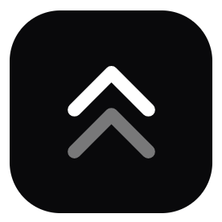
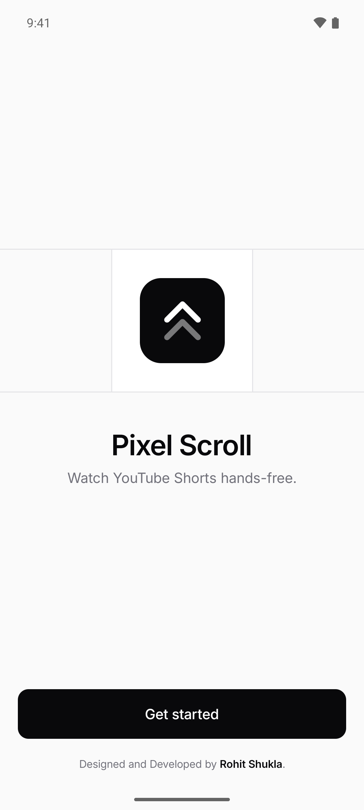
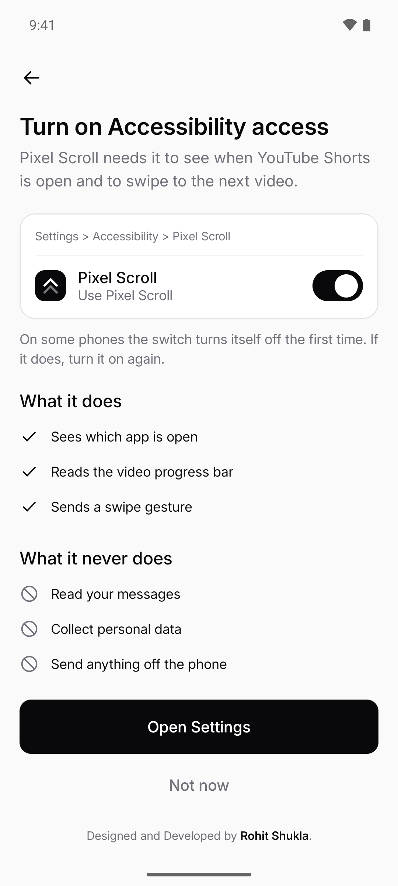
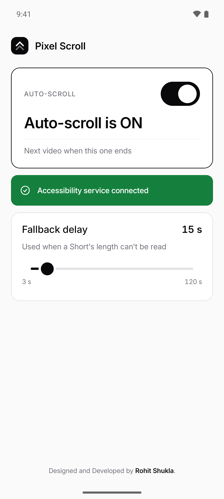

<p align="center">
  
</p>

<h1 align="center">Pixel Scroll</h1>

<p align="center"><b>Hands-free YouTube Shorts: swipes to the next Short the moment one ends.</b></p>

<p align="center">
  <a href="https://github.com/rohitshukla001/PixelScroll/raw/main/apk/PixelScroll.apk"><b>⬇ Download the APK</b></a>
  &nbsp;·&nbsp; Android 8.0+ &nbsp;·&nbsp; No internet permission &nbsp;·&nbsp; Free
</p>

<!-- Demo GIF goes here: docs/images/demo.gif, a 5–10 s phone recording of a Short ending and the next one sliding in. -->

## Screenshots

| Welcome | Accessibility access | Home |
| --- | --- | --- |
|  |  |  |

## Install in 3 steps

1. **Download** [`PixelScroll.apk`](https://github.com/rohitshukla001/PixelScroll/raw/main/apk/PixelScroll.apk) on your Android phone.
2. **Install** it. If Android asks, allow installs from your browser or file manager. If Google Play Protect warns about an unknown app, tap **More details**, then **Install anyway**: Pixel Scroll is not on the Play Store, and it uses an accessibility service.
3. **Turn on access.** Open Pixel Scroll, tap **Get started**, then **Open Settings**, and turn on **Pixel Scroll** under Accessibility. On some phones the switch needs a second try.

Then open YouTube Shorts and watch. The full walkthrough is in the [user guide](docs/user-guide.md).

## Privacy

Pixel Scroll has **no internet permission**, so it can't send anything off your phone. It collects no data, keeps no history and shows no ads. It checks which app is in front, and reads only YouTube's screen, to find the Short's length and progress bar. It never reads other apps' screens. Its only stored data is two settings: auto-scroll on or off, and the fallback delay.

## What it does

Pixel Scroll is an Android app that scrolls YouTube Shorts for you. It moves to the next Short when the current one ends. After setup, it shows nothing inside YouTube.

The app has three screens: Welcome (first launch), Accessibility access (one-time setup) and Home. Home turns auto-scroll on or off and sets the fallback delay.

It swipes when each Short ends, worked out from the Short's length and its progress bar. A Short whose length can't be read swipes after the fallback delay (3 s to 120 s). Instagram Reels is not supported.

## Tech stack

- Kotlin, Jetpack Compose, Material 3
- Android 8.0 (API 26) and later
- Gradle 8.11.1 with the Kotlin DSL and a version catalog (`gradle/libs.versions.toml`)

## Project structure

```
apk/                           Latest built APK (PixelScroll.apk)
app/src/main/java/dev/rohitshukla/pixelscroll/
├── MainActivity.kt            Screens host; implements the app's actions
├── service/                   Accessibility service, scroll engine, screen check, swipe
├── scroll/                    When to swipe (pure Kotlin, unit tested)
├── progress/                  Progress-bar reading and seek bar text (pure Kotlin, unit tested)
├── data/                      Settings (DataStore, on the phone only)
└── ui/                        Theme, components and the three screens from the design system
docs/                          User, developer, engineering and performance guides
```

## Build

You need JDK 17 and the Android SDK. Android Studio installs both.

```bash
./gradlew assembleDebug
```

Each debug build copies the APK to `apk/PixelScroll.apk`, replacing the old one. That folder always holds one APK: the latest build.

## Docs

- [User guide](docs/user-guide.md): install, setup, Home, troubleshooting.
- [Developer guide](docs/developer.md): how the app works inside and where to change it.
- [Engineering handbook](docs/engineering-handbook.md): rules, workflow, checks and emulator testing.
- [Performance](docs/performance.md): what the app costs the phone, and what is not measured yet.

## Design

The UI follows the Pixel Scroll "Monochrome Futuristic" design system: black, white and neutral grey, Inter type, thin borders and no shadows. The app is light only, even when the phone is in dark mode.

## Disclaimer

Pixel Scroll is an independent project. It is not affiliated with, endorsed by or sponsored by YouTube or Google. YouTube is a trademark of Google LLC.

Pixel Scroll automates swipes in the YouTube app through Android's accessibility service. You use it at your own risk and are responsible for following YouTube's Terms of Service. The software is provided "as is", without warranty of any kind; see the [License](LICENSE).

## License

Copyright 2026 Rohit Shukla

Pixel Scroll is licensed under [Creative Commons Attribution-NoDerivatives 4.0 International (CC BY-ND 4.0)](https://creativecommons.org/licenses/by-nd/4.0/). See [LICENSE](LICENSE).

- You may download, install, use and share Pixel Scroll, including the APK, as long as you credit Rohit Shukla and link to the license.
- You may not share modified versions.

Pixel Scroll is source-available, not open source: you can read the code, but the license does not allow sharing changed copies.

The Inter font in `app/src/main/res/font/` is licensed separately under the [SIL Open Font License 1.1](licenses/Inter-OFL.txt).

---

Design and Developed by Rohit Shukla
